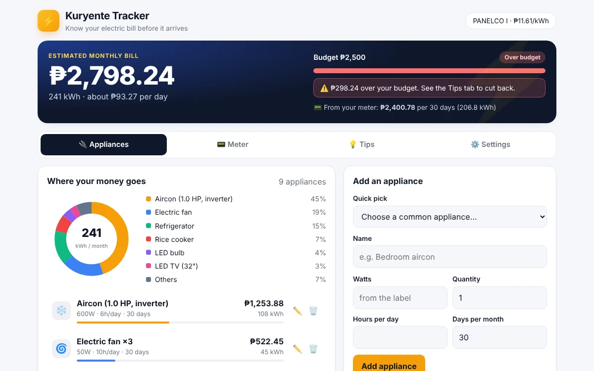

# ⚡ Kuryente Tracker

**Know your electric bill before it arrives.**
Live app: **https://ellieboy112.github.io/kuryente-tracker/**

Kuryente Tracker estimates your monthly electric bill from the appliances you own, tracks your real usage from meter readings, warns you when you are about to go over budget, and suggests personalised ways to save. It ships with current rates for PANELCO I and other Pangasinan utilities.

I built it after my work immersion at PANELCO I, where I saw how hard it is for households to tell *which* appliance is behind a high bill.



## Features

- **Appliance bill estimator:** add appliances (or pick from 18 common Filipino household appliances) and see each one's kWh, peso cost, and share of the bill in a donut chart.
- **Meter reading log:** record meter readings to see real usage per period, a daily-usage chart, and a projected 30-day bill.
- **Energy-saving tips:** personalised tips for your biggest consumers, with the pesos you'd save.
- **Budget alert:** set a monthly budget; get a warning at 85% and an alert when you go over.
- **Private by design:** no sign-up and no server. Data stays in your browser, with backup and restore as a JSON file.
- Light and dark mode, mobile-first, keyboard and screen-reader friendly.

## Tech stack

React 19 · TypeScript (strict) · Vite · Vitest · Oxlint · plain CSS · GitHub Pages

## Run it locally

```bash
npm install
npm run dev      # start the dev server
npm test         # run unit tests
npm run lint     # lint the source
npm run build    # type-check and build to /docs (what GitHub Pages serves)
```

---

## System guide (how it works)

### 1. The big picture

```
 User ──► React components (UI) ──► calc.ts / tips.ts (pure logic)
              │    ▲
              ▼    │  state
          storage.ts ◄──► localStorage (the browser's built-in storage)
```

It's a **single-page app (SPA)**: the browser downloads one HTML file plus one JS and one CSS bundle, then everything runs on the user's device. There are no page reloads and no server requests.

### 2. The "backend": there isn't a server, on purpose

Most apps send data to a server and database. This one doesn't need to:

- **Storage:** `src/lib/storage.ts` saves the whole app state as one JSON object in the browser's **localStorage** under the key `kuryente-tracker:v1`. It loads on start and saves automatically on every change (the `usePersistentData` hook).
- **Safety:** if the saved data is missing or broken, the app falls back to sample data instead of crashing. Missing fields are merged with defaults.
- **Why no server?** It's free to host (GitHub Pages serves static files), fast, and **private**: a household's usage never leaves their phone.
- **Trade-off:** data lives on one device and browser. Clearing browser data erases it, so the Settings tab has **Download backup / Restore backup** (a JSON file).

If I needed accounts or syncing across devices, I would add a real backend such as **Supabase** (like in my I-Judge project): a `households`, `appliances` and `readings` table with row-level security, and swap `storage.ts` for Supabase calls. The rest of the app wouldn't change, because all data access goes through that one file.

### 3. The logic layer (`src/lib/`)

| File | What it does |
|---|---|
| `calc.ts` | All the math as **pure functions** (same input gives the same output). `kWh = watts × qty × hours/day × days ÷ 1000`; `cost = kWh × rate`; meter periods; 30-day projection; budget status (ok / warning ≥85% / over). |
| `tips.ts` | Builds personalised tips from the top 3 consumers. Always-on appliances (fridge, router) get a "10% from better habits" saving instead of "1 hour less". |
| `presets.ts` | 18 appliance presets and utility rates (PANELCO I ₱11.61/kWh as of Oct 2026, etc.). |
| `applianceForm.ts` | Form validation with friendly error messages. |
| `storage.ts` | Load and save to localStorage (the "backend"). |
| `sampleData.ts` | Demo household shown on first visit, so recruiters never see an empty app. |
| `format.ts` | Peso, kWh and date formatting with `Intl.NumberFormat('en-PH')`. |

### 4. The UI layer (`src/components/`)

- `App.tsx`: holds all state, computes the summary, and switches between 4 tabs.
- `SummaryCard`: the big estimated bill, budget bar and alert, and the meter projection.
- `AppliancesTab` + `ApplianceForm` + `DonutChart`: the list, breakdown chart, and add/edit form.
- `MeterTab`: add readings (validated: a meter only goes up), usage bar chart, and history table.
- `TipsTab` and `SettingsTab`: tips; rate, budget, backup, and reset.

Data flows **one way**: `App` passes data down as props, and components call `onChange(...)` to send updates up. `App` updates state, which saves to storage and re-renders the screen.

### 5. Quality

- **TypeScript strict mode** catches type errors before the app runs.
- **15 unit tests** (Vitest) for the math, meter logic, budget, tips, and validation: `npm test`.
- **Linting** with Oxlint (0 warnings).
- Charts are hand-built with SVG and CSS (no chart library), so the bundle stays small (~78 KB gzipped).

### 6. Deployment

`npm run build` type-checks, then Vite bundles the app into `/docs` with the base path `/kuryente-tracker/`. GitHub Pages is set to serve the `main` branch's `/docs` folder.

---

*Estimates only. Your actual bill depends on your utility's monthly rate and charges. Rates from tipidkuryente.ph (Oct 2026).*

Made by [Ellison Olivo](https://ellieboy112.github.io)
